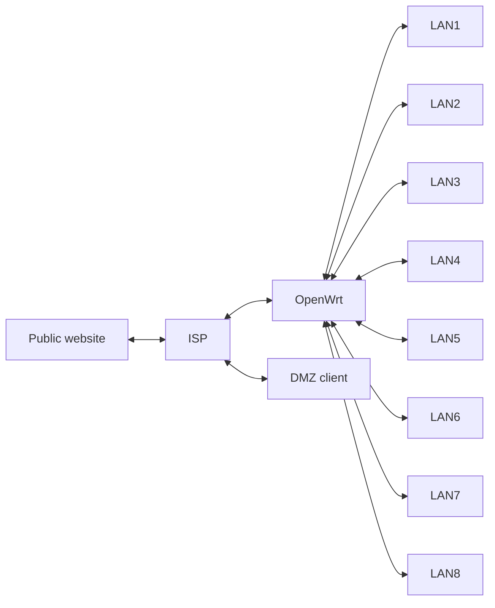

# ndp64lab

An isolated eleven-container OpenWrt 24.10.4 lab for one shared IPv6 /64
across eight separate LANs. The containers use nine Docker bridge links: one
ISP-to-WAN link and one link per LAN. LAN1 has two clients; LAN2 through LAN8
have one each. Docker's bridge-assigned addresses are replaced with the lab's
fixed IPv4 fixtures. No host interface addresses are read.

## Requirements

Linux x86_64, Docker Engine with buildx, Bash, and permission to create
privileged containers and bridge networks. The router image builds on the
digest-pinned OpenWrt x86/64 24.10.4 container image and builds a static Go
helper in a separate stage. It installs `ip-full` from OpenWrt's 24.10.4
package feed, so the first build needs Internet access.

## Lifecycle

From the repository root:

```sh
./lab up       # build and start
./lab test     # run acceptance checks against the live lab
./lab reset    # purge, rebuild, start, and test
./lab purge    # remove only ndp64lab resources and generated files
```

Each applet takes no extra arguments. `up` reports an existing lab; use `reset`
to start over. The project name is fixed as `ndp64lab`, so moving or renaming
the checkout does not change Docker resource names. `purge` selects containers,
networks, and images by the `org.ndp64lab.owner=ndp64lab` label. The dedicated
`ndp64labbuilder` buildx instance is removed only when its ownership marker is
present under `.generated`. The generated directory is ignored by Git.

## Topology

The following topology is planned and not yet implemented. The lab described
above and under **Current Fixed Addressing** below still uses the existing
eleven-container topology and addresses.



| Link | Endpoint | IPv4 | IPv6 |
| --- | --- | --- | --- |
| Public | ISP | `76.65.66.1/30` | `2076:65:66::1/64` |
| Public | Website | `76.65.66.2/30` | `2076:65:66::2/64` |
| Customer | ISP | `108.97.98.100/31` | `2108:97:98:100::1/64` |
| Customer | OpenWrt | `108.97.98.101/31` | `2108:97:98:100::2/128` |
| DMZ | ISP | `108.97.98.200/31` | `2108:97:98:200::1/64` |
| DMZ | DMZ client | `108.97.98.201/31` | `2108:97:98:200::2/64` |

The website uses the ISP's `76.65.66.1` and `2076:65:66::1` as its return
gateways. OpenWrt uses `108.97.98.100` as its direct IPv4 gateway, and the DMZ
client uses `108.97.98.200`. The ISP keeps `108.97.98.1/32` as a separate
identity address; it is not a direct link gateway. No IPv4 proxy ARP is needed.

The eight LANs share `2108:97:98:100::/64` with the customer link, using the
current model of client `/128` routes and NDP proxying across WAN and LANs.
The customer and DMZ address pools, `108.97.98.0/24` and
`2108:97:98::/48`, are routed aggregates, not connected link masks; the links
use the masks shown in the table.

The decimal ASCII codes `108`, `97`, and `98` spell lowercase **lab**;
`76`, `65`, and `66` spell uppercase **LAB**. The IPv6 forms prepend `2` to
the zero-padded, three-digit first code: `108` becomes `2108`, and `076`
becomes `2076`.

### Expected Traffic

For the planned topology:

- Clients on different LANs can communicate over IPv4 and IPv6.
- Lab clients and the DMZ client can access the public website over both
  IPv4 and IPv6. Each HTTP request returns fresh random printable ASCII.
- Lab clients and the DMZ client can ping each other over IPv6.
- New inbound TCP connections to lab clients remain blocked by OpenWrt's
  firewall. Inbound IPv4 access to lab clients is not promised.

## Current Fixed Addressing

The ISP has `198.18.0.1/30`, `fd42:6e64:7000:1::1/64`, and `fe80::1` on WAN,
plus `fd42:6e64:7000:2::2/128` on loopback. OpenWrt has `198.18.0.2/30` and
`fd42:6e64:7000:1::2/128` on `eth0`, with its IPv6 default route via
`fe80::1`. `eth1` through `eth8` have `192.168.1.1/24` through
`192.168.8.1/24`. Clients use `.10` on their LAN; the second LAN1 client uses
`192.168.1.11/24`. Each client uses its LAN router address as the IPv4 default
gateway. All clients receive one on-link, autonomous
`fd42:6e64:7000:1::/64` prefix via Router Advertisements from the helper.
DHCPv6 is disabled on each LAN, and clients do not generate temporary IPv6
addresses.

OpenWrt's firewall keeps the normal LAN-to-WAN forwarding, WAN rejection, and
ICMPv6 forwarding behavior. The in-router helper sends RAs, learns client
addresses from LAN packets, installs `/128` routes, and proxies NDP for each
client on WAN and the other seven LANs. It also proxies the ISP's on-link `::1`
address on every LAN so replies can reach the ISP. The helper does not proxy a
client address on that client's own LAN, leaving same-LAN traffic on the Docker
bridge rather than in OpenWrt's forwarding path. A `/128` route sends the ISP's
`::1` address to WAN; an unreachable route for the shared `/64` rejects unknown
destinations instead of sending them to the ISP.

`test` checks that each client has one global SLAAC address, IPv4 and IPv6
traffic between every pair of LANs, outbound IPv4 to the ISP, IPv6 in both
directions with the ISP, upstream NDP, blocked new inbound TCP, and direct LAN1
peer routing and MAC resolution. It also checks that unknown addresses in the
shared prefix are unreachable. A temporary nftables counter checks that LAN1
peer traffic does not enter OpenWrt's forwarding path.

When diagnosing a failed run, `docker exec ndp64labrouter logread` shows
OpenWrt and helper logs. `./lab purge` also works after a partial `up`.
