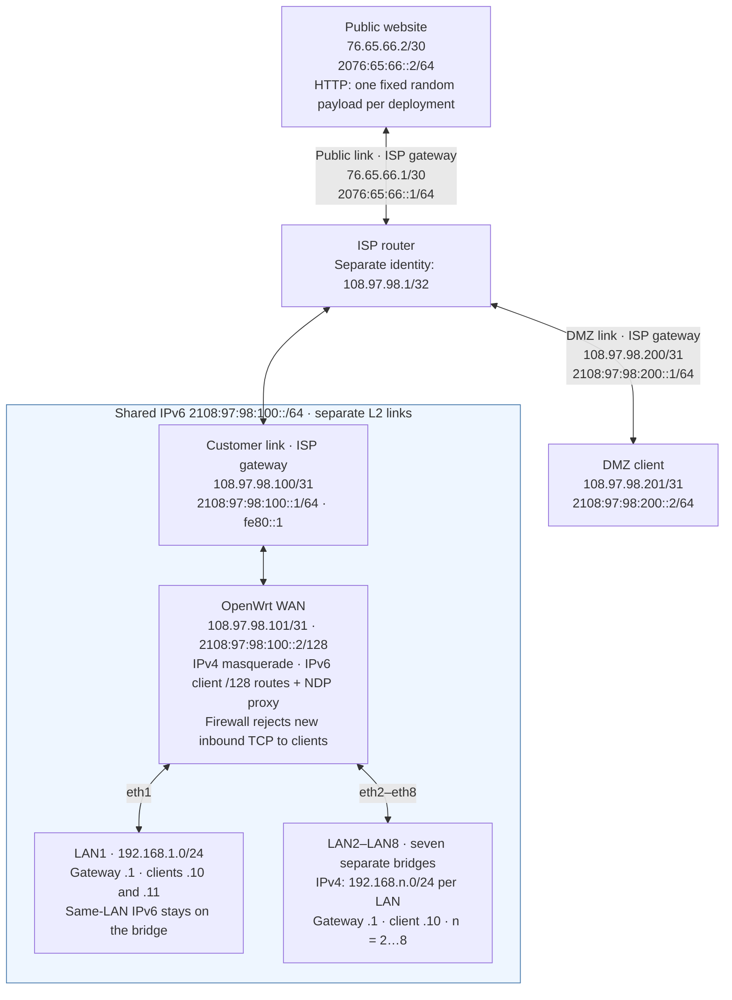

# ndp64lab

An isolated thirteen-container OpenWrt 24.10.4 lab for one shared IPv6 /64
across eight separate LANs. The containers use eleven Docker bridge links:
ISP-to-WAN, ISP-to-public-website, ISP-to-DMZ, and one link per LAN. LAN1 has
two clients; LAN2 through LAN8 have one each. Docker's bridge-assigned addresses are replaced with the lab's
generated IPv4 fixtures. No host interface addresses are read.

## Requirements

Linux x86_64, Docker Engine with buildx, Bash, and permission to create
privileged containers and bridge networks. The router image builds on the
digest-pinned OpenWrt x86/64 24.10.4 container image and builds a static Go
helper in a separate stage. It installs `ip-full` from OpenWrt's 24.10.4
package feed, so the first build needs Internet access.

## Lifecycle

From the repository root:

```sh
./lab up       # build and start
./lab test     # run acceptance checks against the live lab
./lab reset    # purge, rebuild, start, and test
./lab purge    # remove only ndp64lab resources and generated files
```

Each applet takes no extra arguments. `up` reports an existing lab; use `reset`
to start over. The project name is fixed as `ndp64lab`, so moving or renaming
the checkout does not change Docker resource names. `purge` selects containers,
networks, and images by the `org.ndp64lab.owner=ndp64lab` label. The dedicated
`ndp64labbuilder` buildx instance is removed only when its ownership marker is
present under `.generated`. The generated directory is ignored by Git.

## Topology

The ISP connects OpenWrt, a public website, and a separate DMZ client.
The following naming table is the source of truth for generated addresses.
`./lab up` and `./lab test` extract only `address-seed:` rows within this
Topology section; the keys identify the customer/DMZ and public address pools.
Each value must be three ASCII letters, and the two values must differ.

| Address naming key | ASCII name | Used for |
| --- | --- | --- |
| `address-seed:customer` | `lab` | ISP identity, customer link, shared LAN IPv6 prefix, and DMZ |
| `address-seed:public` | `LAB` | Public website link |

The diagram shows the generated addresses for these names, including the ISP
gateway on each link and the separate ISP identity address. The shaded area
highlights the unusual part: one IPv6 `/64` spans the customer link and eight
separate LANs, while each LAN has its own IPv4 subnet. Configuration and tests
calculate addresses from the naming table; the diagram is an example.



The website uses the ISP's `76.65.66.1` and `2076:65:66::1` as its return
gateways. OpenWrt uses `108.97.98.100` as its direct IPv4 gateway, and the DMZ
client uses `108.97.98.200`. The ISP keeps `108.97.98.1/32` as a separate
identity address; it is not a direct link gateway. No IPv4 proxy ARP is needed.

The eight LANs share `2108:97:98:100::/64` with the customer link, using the
current model of client `/128` routes and NDP proxying across WAN and LANs.
The customer and DMZ address pools, `108.97.98.0/24` and
`2108:97:98::/48`, are routed aggregates, not connected link masks; the links
use the masks shown in the diagram.

The decimal ASCII codes `108`, `97`, and `98` spell lowercase **lab**;
`76`, `65`, and `66` spell uppercase **LAB**. The IPv6 forms prepend `2` to
the zero-padded, three-digit first code: `108` becomes `2108`, and `076`
becomes `2076`.

### Expected Traffic

Acceptance checks cover:

- Clients on different LANs can communicate over IPv4 and IPv6.
- Lab clients and the DMZ client can access the public website over both
  IPv4 and IPv6. Each deployment generates a fresh 4096-byte random printable
  ASCII file,
  served unchanged for the lifetime of that deployment. HTTP responses use
  `text/plain`; tests require successful responses with bodies identical to
  `.generated/www/index.html` over both protocols. Repeated requests and
  `./lab test` preserve the payload; `./lab reset` generates a new one.
- Lab clients and the DMZ client can ping each other over IPv6.
- New inbound TCP connections to lab clients remain blocked by OpenWrt's
  firewall. Inbound IPv4 access to lab clients is not promised.

The address generator and payload creation can also be checked without Docker:

```sh
bash tests/address-generation.sh
```

After changing a naming seed, run `./lab reset` to deploy the new addresses;
`./lab test` rejects seeds that differ from the running deployment's manifest.

## Routing and Addressing

The WAN and ISP links use the generated addresses shown above. OpenWrt's
IPv6 default route uses the ISP's WAN link-local address, `fe80::1`. Its
`eth1` through `eth8` have `192.168.1.1/24` through `192.168.8.1/24`.
Clients use `.10` on their LAN; the second LAN1 client uses `192.168.1.11/24`.
Each client uses its LAN router address as the IPv4 default gateway. OpenWrt
masquerades outbound IPv4 traffic. All clients receive the generated shared
customer `/64` as an on-link, autonomous prefix via Router Advertisements
from the helper. DHCPv6 is disabled on each LAN, and clients do not generate
temporary IPv6 addresses. The ISP forwards between its three links; the DMZ
and website use it as their default gateway.

OpenWrt's firewall keeps the normal LAN-to-WAN forwarding, WAN rejection, and
ICMPv6 forwarding behavior. The in-router helper sends RAs, learns client
addresses from LAN packets, installs `/128` routes, and proxies NDP for each
client on WAN and the other seven LANs. It also proxies the ISP's on-link `::1`
address on every LAN so replies can reach the ISP. The helper does not proxy a
client address on that client's own LAN, leaving same-LAN traffic on the Docker
bridge rather than in OpenWrt's forwarding path. A `/128` route sends the ISP's
`::1` address to WAN; an unreachable route for the shared `/64` rejects unknown
destinations instead of sending them to the ISP.

`test` checks that each client has one global SLAAC address, IPv4 and IPv6
traffic between every pair of LANs, outbound IPv4 to the ISP, IPv6 in both
directions with the ISP and DMZ, HTTP payload integrity over both protocols
from every lab client and the DMZ, upstream NDP, blocked new inbound TCP, and
direct LAN1 peer routing and MAC resolution. It also checks that unknown addresses in the
shared prefix are unreachable. A temporary nftables counter checks that LAN1
peer traffic does not enter OpenWrt's forwarding path.

When diagnosing a failed run, `docker exec ndp64labrouter logread` shows
OpenWrt and helper logs. `./lab purge` also works after a partial `up`.
